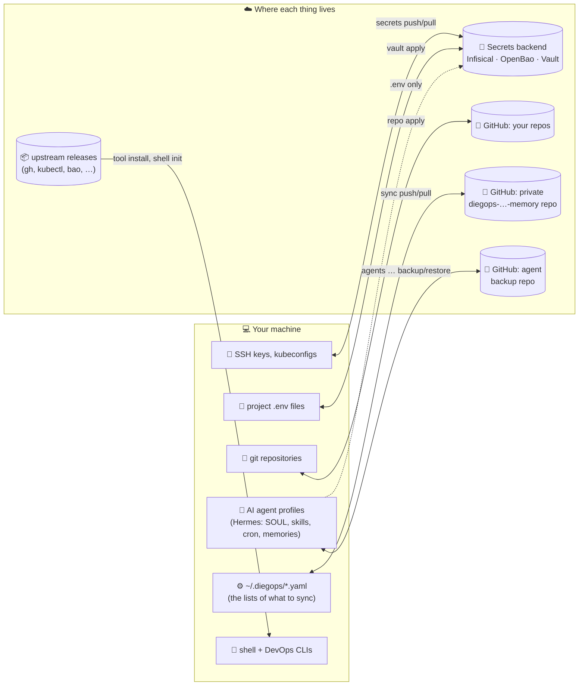
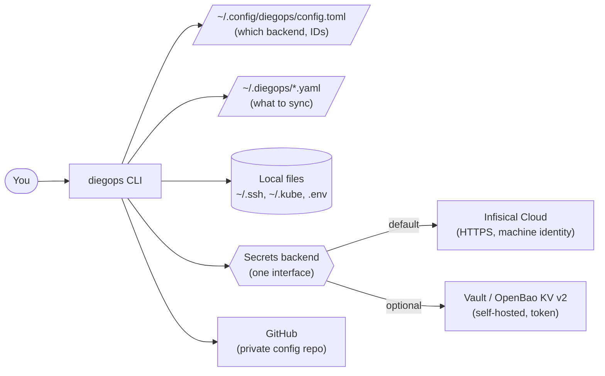
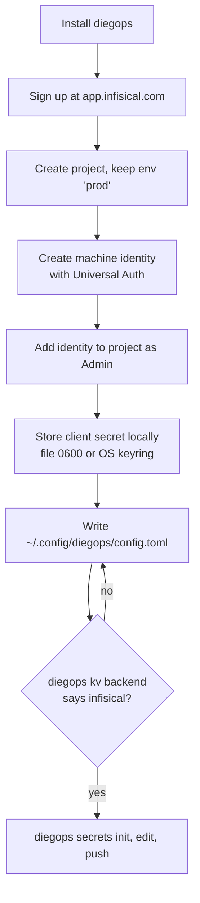
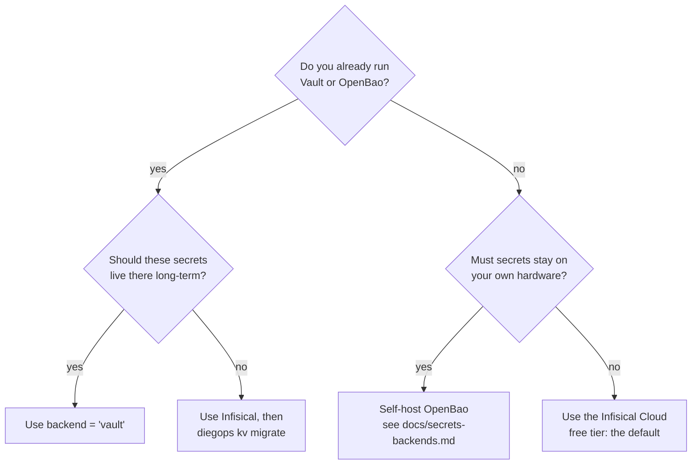
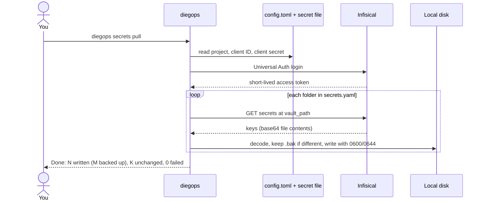
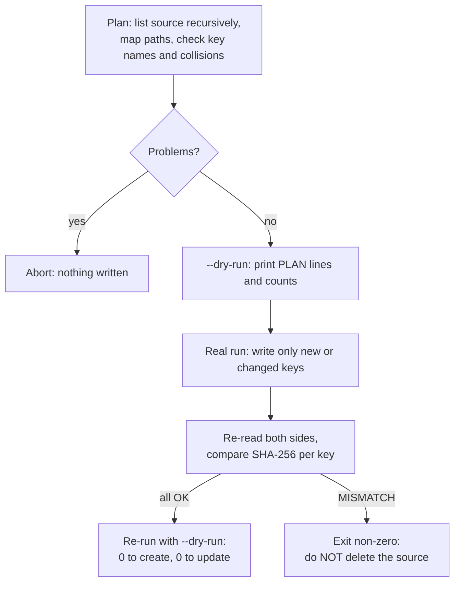
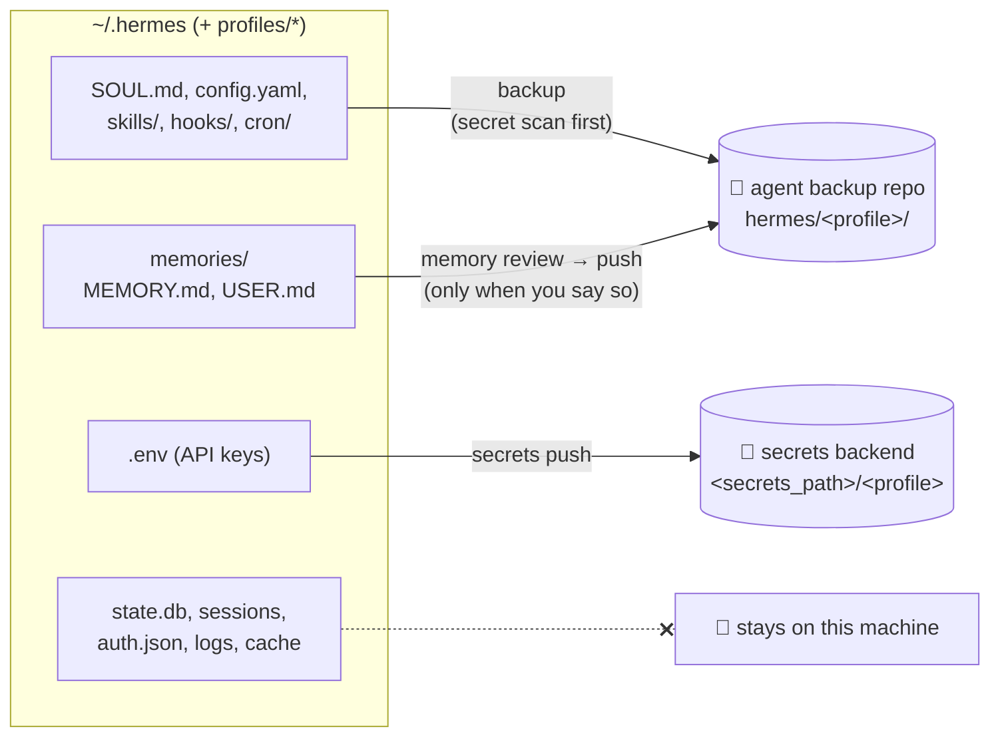
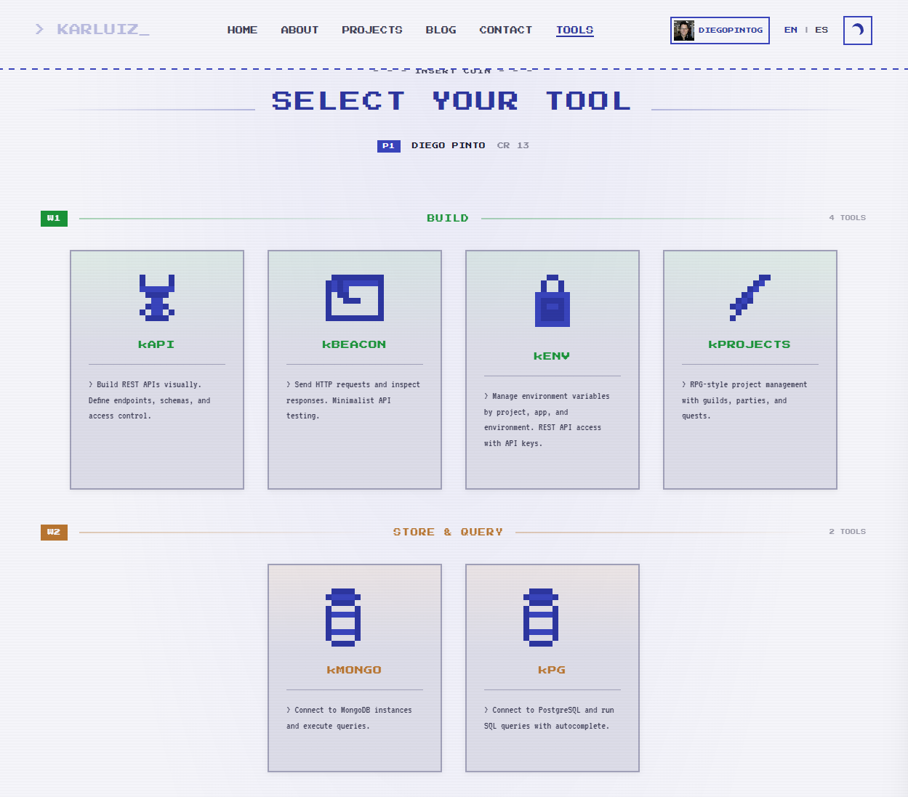

# diegops

[](https://github.com/CaDi-Team/diegops-tools/actions/workflows/ci.yml)
[](LICENSE)

**One command to turn a fresh computer into *your* computer.**

`diegops` is a single, self-contained command-line program that sets up your workstations and keeps them in sync:
your git repositories, your SSH keys and kubeconfigs, your `.env` files, your shell, your DevOps tools and
your AI agents' context. Secrets are stored in a secrets manager (Infisical Cloud by default, or your own
Vault/OpenBao), never in git.

```console
$ diegops all push      # this machine  -> the cloud   (back up)
$ diegops bootstrap     # the cloud     -> new machine (restore everything)
```

## In one picture

A workstation is a pile of things that are painful to rebuild by hand. `diegops` sorts each one into the
place where it belongs, so that one command can put it back:



**The rule behind it:** anything secret goes to the secrets backend, anything that is only configuration goes to
git, and nothing secret is ever written to git or printed on screen.

| What | Stored in | Back up | Restore |
|---|---|---|---|
| SSH keys, kubeconfigs, any file you list | Secrets backend | `diegops secrets push` | `diegops secrets pull` |
| Project `.env` files | Secrets backend | (you edit them in the backend) | `diegops vault apply` |
| Git repositories | GitHub (they are already there) | — | `diegops repo apply` |
| The lists above (`~/.diegops/*.yaml`) | Private GitHub repo | `diegops sync push` | `diegops sync pull` |
| AI agent profiles (Hermes) | Agent backup repo + `.env` in the secrets backend | `diegops agents hermes backup` | `diegops agents hermes restore` |
| zsh, oh-my-zsh, DevOps CLIs | Downloaded from upstream | — | `diegops shell init`, `diegops tool install` |
| **Everything** | | **`diegops all push`** | **`diegops bootstrap`** |

## Contents

- [Who is it for?](#who-is-it-for)
- [In one picture](#in-one-picture)
- [How it works](#how-it-works)
- [Install](#install)
- [Quick start: secrets in 5 minutes with Infisical Cloud](#quick-start-secrets-in-5-minutes-with-infisical-cloud)
- [Which backend should I use?](#which-backend-should-i-use)
- [Alternative: Vault or OpenBao (self-hosted)](#alternative-vault-or-openbao-self-hosted)
- [secrets.yaml explained](#secretsyaml-explained)
- [Daily workflows](#daily-workflows)
- [AI agents: back up and restore Hermes](#ai-agents-back-up-and-restore-hermes)
- [Troubleshooting](#troubleshooting)
- [Security notes](#security-notes)
- [Command reference](#command-reference)
- [Other commands](#other-commands) (repo, vault, auth, sync, tool, ktool, shell, devtools)
- [Credits](#credits--karluiz-tools) · [Acknowledgements](#acknowledgements--open-source-tools) · [Development](#development)

More detail lives in [docs/](docs/README.md).

---

## Who is it for?

- **You use more than one machine** (laptop, desktop, WSL, a VM, a container) and want them all set up the same way.
- **You re-install often** or get new hardware, and you're tired of copying `~/.ssh` and `.env` files by hand.
- **You want secrets out of git and out of chat**, but don't want to run a server just for that.

You only need to be comfortable typing commands into a terminal. Every step below says what to type and what you should see.

## How it works



- **Secrets** (SSH keys, kubeconfigs, `.env` values) go to the secrets backend. `diegops` talks to it directly over HTTPS, so no extra CLI is needed.
- **Non-secret config** (`~/.diegops/*.yaml`) is backed up to a private GitHub repo by `diegops sync`.
- **Local files** are written with safe permissions (`0600`; `*.pub` files get `0644`; folders `0700`) and backed up to `.bak` before being overwritten.

---

## Install

Pre-built binaries are on [GitHub Releases](https://github.com/CaDi-Team/diegops-tools/releases/latest).

| Your system | File to download (`<V>` = version, e.g. `v1.6.0`) |
|---|---|
| macOS, Apple Silicon (M1–M4) | `diegops-<V>-aarch64-apple-darwin.tar.gz` |
| macOS, Intel | `diegops-<V>-x86_64-apple-darwin.tar.gz` |
| Linux x86_64 (Ubuntu, Debian, Fedora, Bazzite, RHEL) | `diegops-<V>-x86_64-unknown-linux-gnu.tar.gz` |
| Linux x86_64, static (Alpine, containers) | `diegops-<V>-x86_64-unknown-linux-musl.tar.gz` |
| Linux ARM64, static (Raspberry Pi, ARM containers) | `diegops-<V>-aarch64-unknown-linux-musl.tar.gz` |
| Windows x86_64 | `diegops-<V>-x86_64-pc-windows-gnu.zip` |

### Linux / macOS

```sh
# 1. Pick your target from the table above
TARGET=x86_64-unknown-linux-gnu        # macOS Apple Silicon: aarch64-apple-darwin

# 2. Download the latest release
VERSION=$(curl -fsSL https://api.github.com/repos/CaDi-Team/diegops-tools/releases/latest | grep '"tag_name"' | cut -d'"' -f4)
curl -fsSL "https://github.com/CaDi-Team/diegops-tools/releases/download/${VERSION}/diegops-${VERSION}-${TARGET}.tar.gz" | tar -xz

# 3a. Install just for you (no sudo; recommended)
mkdir -p ~/.local/bin && mv diegops ~/.local/bin/
#     make sure ~/.local/bin is on your PATH:
#     echo 'export PATH="$HOME/.local/bin:$PATH"' >> ~/.zshrc   # or ~/.bashrc

# 3b. ...or for every user on the machine
# sudo mv diegops /usr/local/bin/
```

If you install to `~/.local/bin`, `diegops update` can replace itself without `sudo`. `/usr/local/bin` works too, but then updates need `sudo diegops update`.

> macOS may block a downloaded binary the first time you run it. If it does, run `xattr -d com.apple.quarantine ~/.local/bin/diegops`.

### Windows (PowerShell)

```powershell
$repo    = "CaDi-Team/diegops-tools"
$version = (Invoke-RestMethod "https://api.github.com/repos/$repo/releases/latest").tag_name
Invoke-WebRequest "https://github.com/$repo/releases/download/$version/diegops-$version-x86_64-pc-windows-gnu.zip" -OutFile diegops.zip
Expand-Archive diegops.zip -DestinationPath "$env:USERPROFILE\bin" -Force   # add this folder to PATH
```

### Check it worked

```console
$ diegops version
diegops v1.6.3
```

To update later, run `diegops update`. It prints "Already up to date" when there is nothing new.

---

## Quick start: secrets in 5 minutes with Infisical Cloud

### Why Infisical?

[Infisical](https://infisical.com) is a hosted secrets manager. The **free tier** is enough for personal use, and **there is no server for you to run, patch or back up**. `diegops` uses it by default.

These are the free-tier limits that matter here (see [pricing](https://infisical.com/pricing); checked November 2026):

| Limit | What it means for you |
|---|---|
| 5 identities (people + machine identities) | You (1) + one `diegops` machine identity (1) leaves room for 3 more |
| Unlimited projects, 3 environments | One project with the `prod` environment is enough |
| **No secret version history or point-in-time recovery** | An overwrite cannot be undone in Infisical. **Keep your own offline backup** of important keys |
| Rate limits (about 60 reads/min) | `diegops` waits and retries automatically; big runs just take longer |

### First-time setup at a glance



### Step 1. Create an account and a project

1. Sign up at <https://app.infisical.com> (US region) or <https://eu.infisical.com> (EU region). Turn on two-factor authentication.
2. Create an **organization** (any name), then a **Secret Management project**, for example `personal`.
3. Environments: new projects come with `dev`, `staging` and `prod`. `diegops` uses **`prod`** by default, and you can leave the others empty.
4. Open *Project Settings* and copy the **Project ID**. It is an identifier, not a secret.

### Step 2. Create a machine identity

A *machine identity* is a login for a program instead of a person ([Infisical docs](https://infisical.com/docs/documentation/platform/identities/machine-identities)).
`diegops` uses its **Universal Auth** method, which is a Client ID plus a Client Secret ([Infisical docs](https://infisical.com/docs/documentation/platform/identities/universal-auth)).

1. Go to *Organization → Access Control → Identities → Create identity*. Name it `diegops-workstation` and give it the *Member* role.
2. On that identity, add **Universal Auth**. The defaults are fine. An access-token TTL of `2592000` (30 days) avoids frequent re-logins.
3. Copy the **Client ID**. It is not a secret.
4. Click *Create Client Secret*. **It is shown only once**, so keep the browser tab open until Step 3 is done.
5. In your project, go to *Access Control → Machine Identities → Add identity*, choose `diegops-workstation` and give it the **Admin** role. The free tier has no custom roles, and `diegops` needs to create folders.

### Step 3. Store the client secret safely

Pick **one** option. Neither one puts the secret in your shell history.

**Option A: a private file** (works everywhere)

```sh
mkdir -p ~/.config/diegops
install -m 600 /dev/null ~/.config/diegops/infisical-client-secret
read -rs -p "Paste the Infisical client secret, then Enter: " S \
  && printf '%s' "$S" > ~/.config/diegops/infisical-client-secret; unset S; echo
ls -l ~/.config/diegops/infisical-client-secret   # must show -rw-------
```

`read -rs` doesn't show what you paste and doesn't store it in history. `diegops` refuses to read the file if other users can read it.

**Option B: the OS keyring** (Linux with `secret-tool`; on macOS the `security` command works the same way)

```sh
secret-tool store --label "Infisical diegops" service infisical account diegops
# paste the secret at the prompt
```

### Step 4. Write the config file

Create `~/.config/diegops/config.toml`. `diegops` also looks in `$XDG_CONFIG_HOME/diegops/config.toml`, or at any path you put in `$DIEGOPS_CONFIG`.

```toml
# Which backend to use: "infisical" (default) or "vault" (alias "openbao").
backend = "infisical"

[infisical]
# site_url = "https://eu.infisical.com"   # only if your org is in the EU region
project_id  = "<your-project-id>"          # Project Settings → Project ID
environment = "prod"                       # environment slug (default "prod")
client_id   = "<your-machine-identity-client-id>"

# Where the client secret comes from: pick ONE.
client_secret_file = "~/.config/diegops/infisical-client-secret"   # must be chmod 600
# client_secret_command = ["secret-tool", "lookup", "service", "infisical", "account", "diegops"]

# Optional: send one "mount" (the first path segment) to another project, environment or folder.
# By default, path "work/ssh" lives in folder "/work/ssh" of the default project.
# [[infisical.mounts]]
# mount = "work"
# folder = "/work"
# project_id = "<other-project-id>"
# environment = "prod"
```

Unknown keys are rejected, so a typo gives you a clear error instead of being silently ignored.

### Step 5. First commands

```console
$ diegops kv backend
backend: infisical
config:  /home/you/.config/diegops/config.toml

$ printf 'hello' > /tmp/demo.txt
$ diegops kv put demo/hello GREETING=@/tmp/demo.txt
wrote 1 key(s) to 'demo/hello' (infisical)

$ diegops kv get demo/hello                 # key names only
GREETING

$ diegops kv get demo/hello --key GREETING  # one value, raw, to stdout
hello
```

In the Infisical UI you will now see the folder `/demo/hello` with the secret `GREETING` in `prod`. Delete it there when you are done.

Now back up real files:

```console
$ diegops secrets init
Created: /home/you/.diegops/secrets.yaml
Edit the file to add your secrets folders, then run `diegops secrets push`.

$ diegops secrets push
$HOME/.ssh
  PUSH  id_ed25519
  PUSH  id_ed25519.pub
  PUSH  config

Done: 3 pushed, 0 unchanged, 0 failed
```

---

## Which backend should I use?



`diegops` picks the backend in this order: the `--backend` flag, then `$DIEGOPS_SECRETS_BACKEND`, then `backend` in `config.toml`, then `infisical`.

## Alternative: Vault or OpenBao (self-hosted)

`diegops` speaks the Vault **KV v2** HTTP API, which both [OpenBao](https://openbao.org) and [HashiCorp Vault](https://developer.hashicorp.com/vault) implement.

```toml
backend = "vault"

[vault]
address   = "https://bao.example.com"     # no built-in default
namespace = "personal"                     # optional (sent as X-Vault-Namespace)
# ca_cert   = "~/.config/diegops/openbao-ca.pem"   # extra CA for a private PKI
# token_file = "~/.vault-token"            # default; written by `bao login` / `vault login`
```

```sh
bao login -method=oidc          # or: vault login -method=oidc  (writes ~/.vault-token)
diegops kv backend              # backend: vault
diegops kv list secret          # sub-paths of the mount "secret"
```

`VAULT_ADDR`, `VAULT_NAMESPACE`, `VAULT_CACERT` and `VAULT_TOKEN` in the environment **override** the file. See [Troubleshooting](#troubleshooting).

To use the other backend for a single command without changing the config, pass `--backend`: `diegops kv --backend vault list secret`. The flag also works after the subcommand: `diegops kv list secret --backend vault`.

---

## secrets.yaml explained

`~/.diegops/secrets.yaml` lists which local folders are backed up and where they go. You can point to another file with `--config <file>` or `$DIEGOPS_SECRETS_CONFIG`.

```yaml
folders:
  - dest: $HOME/.ssh              # local folder ($HOME works on Linux, macOS and WSL)
    vault_path: workstation/ssh   # logical path <mount>/<path> in the backend
                                  #   Infisical: folder /workstation/ssh
                                  #   Vault/OpenBao: mount "workstation", path "ssh"
    dir_mode: "0700"              # folder permissions (default 0700)
    keys:                         # each file becomes one key
      - name: id_ed25519
        mode: "0600"              # optional; default 0600 (*.pub files get 0644)
      - name: id_ed25519.pub
      - name: config

  - dest: $HOME/.kube
    vault_path: workstation/kube
    keys: "*"                     # every file in the folder (push) or every key (pull)
```

- File contents are base64-encoded before upload, so binary files such as keystores and GPG keys are fine.
- `push` only uploads files that changed, and it merges with what is already stored, so other keys are kept.
- `pull` writes a `.bak` copy before overwriting a file that differs.
- `diegops secrets update` adds `CLAUDE.md` and `AGENTS.md` files found in your `repos.yaml` targets.

## Daily workflows

### Restore a new machine



```sh
# 1. Install diegops (above), then recreate config.toml and the client secret (Steps 3 and 4)
diegops auth gh login <PAT>   # GitHub token, for sync and repo
diegops sync pull             # brings back ~/.diegops/secrets.yaml and the other configs
diegops secrets pull          # restores the files
# or all at once:
diegops bootstrap             # same as: diegops all pull
```

### Back up a new file

Add it to `secrets.yaml` (a new `- name:` entry or a new folder), then run:

```sh
diegops secrets push --path ~/.ssh   # only folders under this path
diegops sync push                    # back up the edited secrets.yaml itself
```

### Check status

```console
$ diegops secrets status
$HOME/.ssh
  SYNCED      id_ed25519
  DIFFERS     config
  LOCAL_ONLY  id_rsa_old
```

| Status | Meaning |
|---|---|
| `SYNCED` | Same on both sides |
| `DIFFERS` | Changed locally or in the backend |
| `LOCAL_ONLY` | Not uploaded yet |
| `VAULT_ONLY` | Only in the backend (the name is historical; it applies to Infisical too) |

### Migrate from Vault/OpenBao to Infisical



```sh
diegops kv migrate secret workstation --dry-run   # mounts or path prefixes
diegops kv migrate secret workstation             # every line must say OK
diegops kv migrate secret workstation --dry-run   # expect 0 to create, 0 to update
```

The migration never deletes anything and never prints values. For the full checklist, see [docs/infisical-migration-runbook.md](docs/infisical-migration-runbook.md).

---

## AI agents: back up and restore Hermes

Local AI agents slowly become valuable: a personality (`SOUL.md`), a config, skills they wrote, scheduled jobs and
memories. Losing a laptop should not mean starting them from zero. `diegops agents` backs that context up to a
**git repo you choose** and puts the agents' `.env` files in your **secrets backend**.

Today it supports [Hermes Agent](https://hermes-agent.nousresearch.com) (`~/.hermes` and every profile under
`~/.hermes/profiles/`). You always name the agent in the command (`diegops agents hermes …`), so more agents can be
added later without surprises.



| Part of a profile | Where it goes | When |
|---|---|---|
| `SOUL.md`, `config.yaml`, `skills/`, `hooks/`, `cron/` jobs | Agent backup repo, `hermes/<profile>/` | `backup` |
| `memories/` (`MEMORY.md`, `USER.md`) | Same repo | Only after `memory review` + `memory push` |
| `.env` | Secrets backend, one folder per profile | `secrets push` |
| Conversations, `state.db`, `auth.json`, tokens, logs, caches | **Nowhere.** Never backed up | — |

Every file is checked by a **secret scanner** before it is committed (API keys, private keys, tokens, …). A file that
matches is held back and reported by file, line and rule, never by value. A known false positive can be allowed by
its SHA-256 in the repo's allowlist, so a real secret is never forced through.

### Set up once

```sh
diegops agents init        # writes a sample ~/.diegops/agents.yaml
```

```yaml
# ~/.diegops/agents.yaml
repo:
  path: ~/github/me/agents-backup              # local clone (created if missing)
  url: https://github.com/me/agents-backup.git # make it PRIVATE
  branch: main
agents:
  - kind: hermes
    root: ~/.hermes
    secrets_path: personal/agents/hermes       # .env of profile P goes to <secrets_path>/P
    # secrets_backend: vault                   # optional; default = your normal backend (Infisical)
```

```sh
diegops agents hermes secrets push   # move every profile's .env into the secrets backend
diegops agents hermes backup         # first backup
```

### Day to day (manual, on purpose)

Backups are a command you run when something worth keeping changed. There is no background job unless you ask for
one (`diegops agents install-timer` installs a daily systemd user timer).

```console
$ diegops agents hermes status
hermes: last OK 0h17m ago (2361 files, 20240555 bytes, 02ed2a8)
  default          in backup   definition changes: 0  memories to review: 2
  moma             in backup   definition changes: 3  memories to review: 0

$ diegops agents hermes backup          # definitions only; commit + push if anything changed
hermes: backed up 2361 files (20244334 bytes) at 36517c7

$ diegops agents hermes memory review   # read the memory diff first…
$ diegops agents hermes memory push     # …then push it
```

`diegops all push` runs the agent backup too, together with `secrets push` and `sync push`.

### On a new machine

```sh
diegops agents hermes restore --to /tmp/check   # dry run: restore under /tmp/check/<profile>
diegops agents hermes restore                   # restore missing profiles + their .env (0600)
diegops agents hermes restore --profile work --force   # overwrite one; old files kept as *.pre-restore
```

`restore` never overwrites an existing profile unless you pass `--force`. `diegops bootstrap` restores any missing
profiles automatically, after the `.env` files are available.

---

## Troubleshooting

Errors go to stderr as `error: <what failed>`, with optional `  hint: <what to do>` lines below. Exit codes: `0` success, `1` the command failed, `2` usage error (unknown command, bad flag or argument).

| Symptom | Cause and fix |
|---|---|
| `kv migrate` shows the wrong source, or prints `warning: VAULT_ADDR env overrides the [vault] config value` | `VAULT_ADDR` or `VAULT_NAMESPACE` set in your shell (for example old `.zshrc` lines) wins over `config.toml`. Run `unset VAULT_ADDR VAULT_NAMESPACE` and remove the exports. |
| `no Vault address configured` | Set `[vault] address`. There is no built-in default. |
| `no Vault token: ...` | Run `bao login -method=oidc` or `vault login`, or set `VAULT_TOKEN`. |
| `no Infisical credentials` or `no Infisical client secret` | Set `client_id` and one of `client_secret_file`, `client_secret_command` or `$INFISICAL_UNIVERSAL_AUTH_CLIENT_SECRET`. |
| `... must not be accessible by group/others (chmod 600)` | Run `chmod 600 ~/.config/diegops/infisical-client-secret`. |
| `no secret at '<path>'` or `FAIL  key '<k>' not found at '<path>'` | Wrong backend, project, environment or path. Check `diegops kv backend`, `diegops kv list <mount>`, the `environment` slug, and that the identity was added to the project. |
| `listing the root is not supported` | `kv list /` is not allowed. Pass a mount instead: `diegops kv list workstation`. |
| Slow runs, HTTP 429 | Free-tier rate limits. `diegops` retries automatically and honours `Retry-After`, so just wait. Re-running is safe. |
| Migrate aborts on an invalid key name | Infisical key names cannot contain `:` or `/`. Rename the key at the source. |
| `client_secret_command '...' exited with ...` | The keyring is locked (common over SSH). Unlock it, or use the file option. |
| Restored SSH or GPG keys ask for a passphrase | `diegops` restores files byte for byte, so the passphrase is still yours to type. Run `ssh-add`, or `gpg-connect-agent reloadagent /bye` for GPG. |

## Security notes

- **Values never go on the command line.** `kv put KEY=value` is refused. Use `KEY=@file` or `KEY=-` (stdin) so nothing lands in shell history or the process list.
- **Nothing secret is printed.** Output shows paths, key names and counts only. The one exception is `kv get --key K`, which you ask for explicitly.
- **Multi-line or whitespace-sensitive values** (PEM keys, values with trailing newlines) are stored in Infisical as `diegops:b64:<base64>`, because Infisical trims values. `diegops` decodes them for you; don't edit those values in the UI.
- Infisical credential order: `INFISICAL_TOKEN`, then `INFISICAL_UNIVERSAL_AUTH_CLIENT_SECRET`, then `client_secret_command`, then `client_secret_file` (which must be `0600`).
- Infisical Free has no secret versioning, so keep an **encrypted offline backup** (for example with `age`) of keys you cannot regenerate.
- The `sync` repo holds no secrets but may hold hostnames and paths. Keep it **private**.

## Command reference

| Command | What it does |
|---|---|
| `diegops help [command…]` | Grouped command list, or help for one command (`diegops help repo apply`). Typos get a "did you mean" hint. |
| `diegops explain [term]` | Plain-words glossary: backend, infisical, machine-identity, pat, kv, … |
| `diegops completion <shell>` / `diegops man` | Shell completion script (bash, zsh, fish, powershell; `shell init` loads it for zsh and bash) / man page (`diegops man \| man -l -`) |
| `diegops version` / `diegops update` | Show the version / self-update |
| `diegops bootstrap` | Full new-machine setup (same as `all pull`) |
| `diegops all pull` | sync pull → SSH keys → repo apply → vault apply → secrets pull → agent restore (missing profiles) → shell init |
| `diegops all push` | secrets push → agent backup → sync push |
| `diegops kv [--backend B] backend` | Show the selected backend and config file |
| `diegops kv list <mount/path>` | List sub-paths |
| `diegops kv get <path> [--key K]` | Key names, or one raw value |
| `diegops kv put <path> K=@file` or `K=-` | Upsert keys (inline values are refused) |
| `diegops kv migrate <prefix>... [--from vault] [--to infisical] [--dry-run]` | Copy, then verify by SHA-256 |
| `diegops secrets init/push/pull/status/update` | Back up or restore the files in `secrets.yaml` (`--path`, `--config`) |
| `diegops vault init/apply/list/list-diff` | Write project `.env` files from the backend |
| `diegops repo init/apply/list/list-diff` | Clone the repos in `repos.yaml` |
| `diegops agents hermes backup/restore/status` | Back up or restore Hermes profiles (`--profile`, `--to`, `--force`, `--no-secrets`) |
| `diegops agents hermes memory review/push` | Review, then push agent memories |
| `diegops agents hermes secrets push` | Move every profile's `.env` into the secrets backend |
| `diegops agents status/init/install-timer` | All agents at a glance / sample registry / optional daily timer |
| `diegops sync push/pull/status` | Back up `~/.diegops/` to a private GitHub repo |
| `diegops auth gh login <PAT>/logout/whoami`, `diegops auth status` | GitHub token |
| `diegops tool list/install/update/remove`, `diegops <tool> ...` | Managed DevOps CLIs |
| `diegops ktool update`, `diegops ktool <args>` | Karluiz tools |
| `diegops shell init` | zsh, oh-my-zsh and the managed shell config |
| `diegops devtools git/gpg/ssh ...` | Git identity, GPG signing, SSH keys |

Environment variables: `DIEGOPS_CONFIG`, `DIEGOPS_SECRETS_BACKEND`, `DIEGOPS_SECRETS_CONFIG`, `DIEGOPS_REPOS_CONFIG`, `DIEGOPS_AGENTS_CONFIG`, `DIEGOPS_PROFILE`, `INFISICAL_API_URL`, `INFISICAL_TOKEN`, `INFISICAL_UNIVERSAL_AUTH_CLIENT_ID`, `INFISICAL_UNIVERSAL_AUTH_CLIENT_SECRET`, `VAULT_ADDR`, `VAULT_NAMESPACE`, `VAULT_CACERT`, `VAULT_TOKEN`.

---

## Other commands

### `diegops repo`: workspace

`~/.diegops/repos.yaml` (override with `--config` or `$DIEGOPS_REPOS_CONFIG`):

```yaml
targets:
  - path: $HOME/github/my-org/products
    repos:
      - git@github.com:my-org/web-front.git
      - git@github.com:my-org/api-service.git
```

`diegops repo init` creates a sample file, `repo apply` clones whatever is missing (safe to re-run), and `repo list-diff` shows what is missing.

### `diegops vault`: `.env` files

Despite its name, this command works with **whichever backend is selected**. Configure it in `~/.diegops/repo-vault.yaml`:

```yaml
targets:
  - path: $HOME/github/my-org/my-app
    secrets:
      - vault_path: apps/my-app/database
        keys: [username, password]
      - vault_path: apps/my-app/api
        keys: "*"
```

`diegops vault apply` writes `.env` (`KEY="value"`), backs up the old file to `.env.bak`, and adds both to `.gitignore`.

### `diegops auth`

Stores a GitHub token in `~/.diegops/tokens/gh.json` (mode 0600). The stored file wins over `$GITHUB_TOKEN`. `auth status` also shows the ktool kenv status.

### `diegops sync`

The first `push` creates a private repo named `diegops-<github-user>-memory`. With `DIEGOPS_PROFILE=work` it uses `diegops-<github-user>-work-memory` instead. It syncs `~/.diegops/` except `tokens/` and `bin/`. `push` overwrites the cloud copy and `pull` overwrites the local one.

### `diegops tool`

Downloads DevOps CLIs into `~/.diegops/bin/`: `gh`, `vault`, `bao` (OpenBao), `terraform`, `helm`, `k9s`, `kubectl`, `jq`, `yq`, `trivy` and `trippy`. Run them as `diegops jq ...`, or put `~/.diegops/bin` on your PATH (`shell init` does this).

### `diegops ktool`

`diegops ktool update` installs [ktool](https://github.com/CaDi-Team/karluiz-tool-cli), and `diegops ktool <args>` forwards to it (for example `diegops ktool kenv list`).

### `diegops shell init`

Installs zsh (with apt, brew, rpm-ostree, dnf or apk), oh-my-zsh and plugins. It writes `~/.diegops/shell/diegops.zsh` (and a bash equivalent) and sources it from `~/.zshrc`. Safe to re-run.

### `diegops devtools`

`git set [--name --email]`, `gpg init|set|restart` and `ssh list|config|create`. The identity comes from the flags, then `git config`, then the GitHub API.

### Directory layout

```
~/.config/diegops/
├── config.toml                # backend selection and IDs (no secrets)
└── infisical-client-secret    # optional, 0600
~/.diegops/
├── bin/                       # managed tools
├── shell/                     # managed shell config
├── tokens/                    # gh.json (0600, never synced)
├── agents.yaml                # AI agent backup registry
├── repos.yaml
├── repo-vault.yaml
└── secrets.yaml
```

---

## Credits — Karluiz Tools

A huge shout-out and all credit where it truly belongs: to my good friend **[Karluiz](https://karluiz.com/)**.

The `diegops ktool` command and everything it wraps exist because Karluiz built the actual tools. This CLI is just a thin shell to make his work fit into a DevOps-native workflow. The real engineering, the ideas and the hard work behind those tools are **100% his**.

Karluiz has been coding since age 7 on a Commodore 64, and he has poured over 30 years of passion into his projects: retro pixel aesthetics, 8-bit RPG mini-games, and a growing collection of **free** developer tools. Go check them out at **[karluiz.com](https://karluiz.com/)**.

<p align="center">
  <a href="https://karluiz.com/">
    
  </a>
</p>

> *"Every line of code is written with the same passion I felt at age 7."* — Karluiz

## Acknowledgements — Open Source Tools

| Tool | Project | Maintainers |
|------|---------|-------------|
| **gh** | [cli/cli](https://github.com/cli/cli) | GitHub |
| **vault** | [hashicorp/vault](https://github.com/hashicorp/vault) | HashiCorp |
| **bao** | [openbao/openbao](https://github.com/openbao/openbao) | The OpenBao Authors (Linux Foundation) |
| **terraform** | [hashicorp/terraform](https://github.com/hashicorp/terraform) | HashiCorp |
| **helm** | [helm/helm](https://github.com/helm/helm) | The Helm Authors (CNCF) |
| **k9s** | [derailed/k9s](https://github.com/derailed/k9s) | Fernand Galiana |
| **kubectl** | [kubernetes/kubectl](https://github.com/kubernetes/kubectl) | The Kubernetes Authors (CNCF) |
| **jq** | [jqlang/jq](https://github.com/jqlang/jq) | The jq community |
| **yq** | [mikefarah/yq](https://github.com/mikefarah/yq) | Mike Farah |
| **trivy** | [aquasecurity/trivy](https://github.com/aquasecurity/trivy) | Aqua Security |
| **trippy** | [fujiapple852/trippy](https://github.com/fujiapple852/trippy) | FujiApple |

Thanks also to [Infisical](https://infisical.com) and [OpenBao](https://openbao.org).

## Development

```sh
cargo build && cargo test
cargo fmt --check
cargo clippy --all-targets -- -D warnings
```

To release, push a `vX.Y.Z` tag from `develop`. GitHub Actions builds every target (cross-compiled with `cargo-zigbuild`) and publishes the release.
